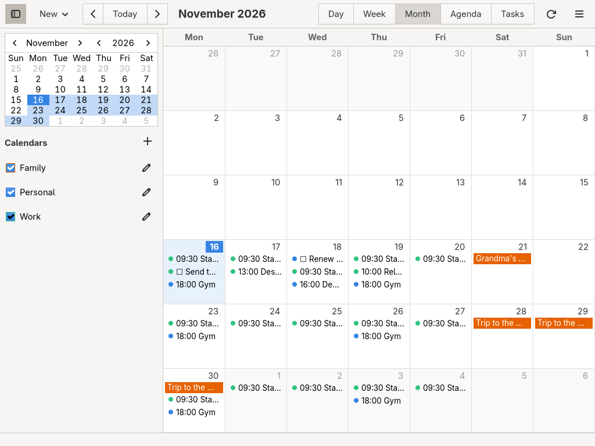
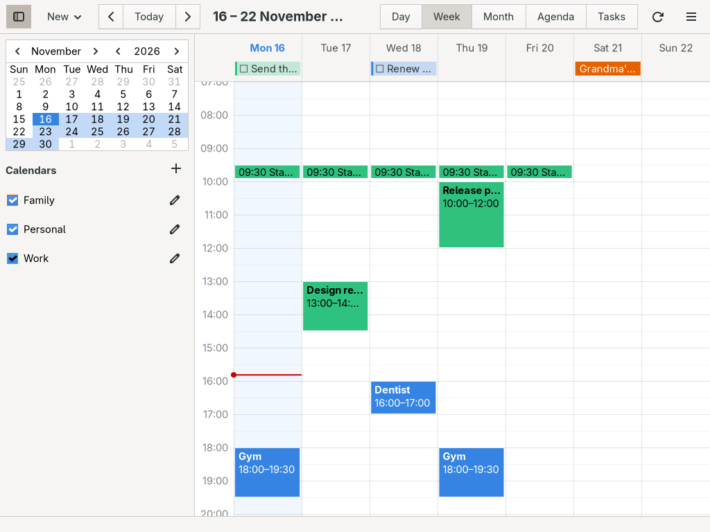
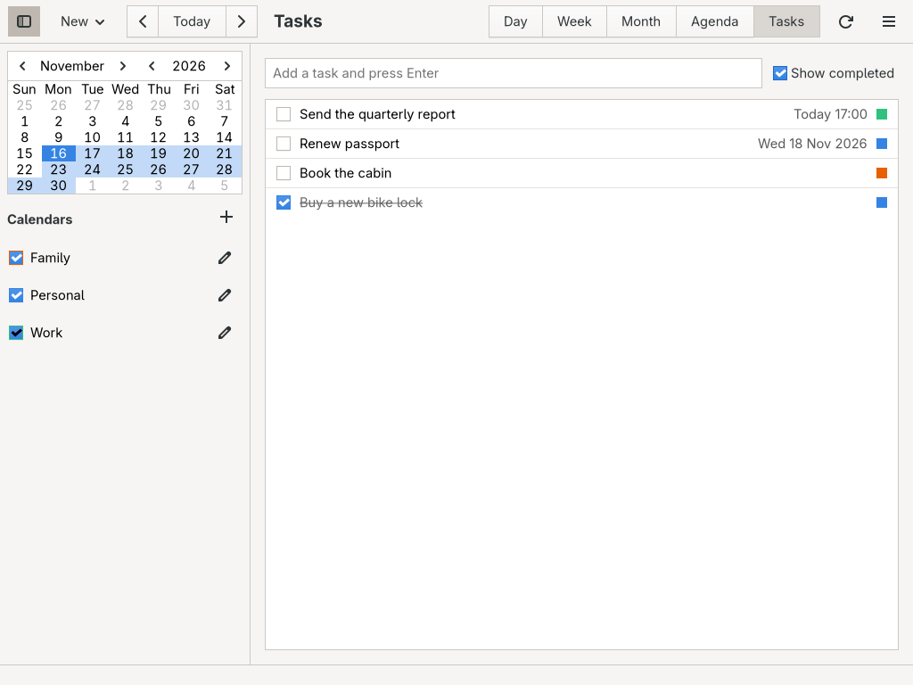

# opencal

 [](https://aur.archlinux.org/packages/opencal-bin) [](https://aur.archlinux.org/packages/opencal-git)

<p align="center"></p>

A local calendar and task manager for Linux, written in Rust with plain GTK 4 (no libadwaita). It works like
KOrganizer or GNOME Calendar, but there are no online accounts. Everything is kept in one iCalendar file on
your disk. To use the calendar on more than one computer, opencal runs your own pull and push commands, the way
KeePassXC syncs its database, and merges the two copies.



| Week view | Tasks |
|---|---|
|  |  |

| Part | Binary / file | Use it for |
|---|---|---|
| App | `opencal` | The calendar window and a command line (`--sync`, `--agenda`, `--import`, …) |
| C library | `libopencal.so`, `opencal.h`, `opencal.pc` | Reading and changing the calendar from C or C++ |
| Rust crate | `opencal` (in `core/`) | The same from Rust |

## Contents

- **[Features](#features)**
- **[Installation](#installation)**
- **[Usage](#usage)**
- **[Sync](#sync)**
- **[The calendar file](#the-calendar-file)**
- **[Library (C, C++ and Rust)](#library-c-c-and-rust)**
- **[Configuration](#configuration)**
- **[Building](#building)**

## Features

- **Five views**: Day, Week, Month, Agenda (the next 60 days) and Tasks, plus a month calendar in the sidebar
  that marks the days that have something on them.
- **Several calendars**, each with its own colour, which you can hide and show.
- **Events**: timed, all-day and multi-day, with location and notes. Repeating daily, weekly (on chosen days),
  monthly or yearly, every N days/weeks/…, ending never, after N times or on a date. Any other iCalendar
  `RRULE` can be typed in. Single occurrences of a series can be deleted.
- **Tasks**: due date (with or without a time), priority, notes, completion. A quick-add field in the Tasks view.
- **Drag and drop** in the Day and Week views: drag on empty space to create an event, drag an event to move it,
  drag its bottom edge to resize it (15-minute steps).
- **Plain file storage**: one `.ics` file that other calendar programs can import. Deletions and completions are
  recorded in it, so two copies merge without a server.
- **Sync with any command**: rclone, scp, git, curl/WebDAV, a shared folder or your own script. The result
  window lists what came in and what went out.
- **Import and export** `.ics` files from other programs (time zones are converted to local time, alarms and
  attendees are kept).
- **Follows the GTK theme**: colours come from the theme (pywal themes included), corners are square and
  windows have no client-side title bar.

## Installation

### Arch Linux (AUR)

| Package | Description |
|---|---|
| [`opencal-bin`](https://aur.archlinux.org/packages/opencal-bin) | Prebuilt x86_64 binary and library from the GitHub release |
| [`opencal-git`](https://aur.archlinux.org/packages/opencal-git) | Built from the latest commit |

### Release tarball

Each [release](https://github.com/TheElevatedOne/opencal/releases) has
`opencal-<version>-linux-x86_64.tar.gz`, built on Arch Linux and laid out for `/usr`
(`bin/`, `lib/`, `include/`, `share/`). It needs GTK 4.14 or newer.

```sh
tar xf opencal-0.1.0-linux-x86_64.tar.gz
sudo cp -a opencal-0.1.0-linux-x86_64/{bin,lib,include,share} /usr/
```

### From source

See [Building](#building).

## Usage

Start `opencal` from your launcher or a terminal.

| Key | Action |
|---|---|
| <kbd>Ctrl</kbd>+<kbd>N</kbd> | New event |
| <kbd>Ctrl</kbd>+<kbd>T</kbd> | New task |
| <kbd>T</kbd> or <kbd>Home</kbd> | Go to today |
| <kbd>Page Up</kbd> / <kbd>Page Down</kbd> | Previous / next day, week or month |
| <kbd>Ctrl</kbd>+<kbd>1</kbd> … <kbd>Ctrl</kbd>+<kbd>5</kbd> | Day, Week, Month, Agenda, Tasks |
| <kbd>F5</kbd> or <kbd>Ctrl</kbd>+<kbd>R</kbd> | Sync |
| <kbd>Ctrl</kbd>+<kbd>I</kbd> / <kbd>Ctrl</kbd>+<kbd>E</kbd> | Import / export iCalendar |
| <kbd>F9</kbd> | Show or hide the sidebar |
| Double-click | New event on that day or at that time |

The command line works without opening a window:

```sh
opencal --agenda 3              # the next 3 days
opencal --add-task "Call the bank"
opencal --import holidays.ics   # into a new calendar called "holidays"
opencal --export - > backup.ics # plain .ics for other programs
opencal --sync                  # run the configured sync, e.g. from a systemd timer
```

```text
Mon 16 Nov 2026
  09:30-09:45  Stand-up
  due 17:00    [ ] Send the quarterly report
Wed 18 Nov 2026
  all day      [ ] Renew passport
```

<details><summary>Full <code>opencal --help</code></summary>

```text
opencal - local calendar and task manager

Usage: opencal [--profile DIR] [COMMAND]

Without a command, opens the calendar window.

Commands:
  --sync                 Run the configured sync (pull, merge, push) and print the changes
  --merge FILE           Merge another opencal calendar file into yours
  --import FILE          Import an .ics file (into a new calendar named after the file)
  --export FILE          Export your events and tasks as plain .ics ("-" = standard output)
  --agenda [DAYS]        Print the next DAYS days (default 7)
  --add-task TEXT        Add a task to the first calendar
  --path                 Print the calendar file's path
  --self-test            Check the store and build every view without showing them
  --screenshot FILE [VIEW]
                         Save a PNG of the window with example data
                         (VIEW: day, week, month, agenda, tasks)
  -h, --help             Show this help
  -V, --version          Show the version

Options:
  --profile DIR          Keep settings and the calendar in DIR (also: OPENCAL_PROFILE)

Files:
  ~/.config/opencal/config.toml     settings, including the sync commands
  ~/.local/share/opencal/calendar.ics   the calendar (iCalendar)
```

</details>

## Sync

opencal has no sync server of its own. Sync works like KeePassXC's: you give it two shell commands.

1. The **pull** command downloads the other copy of the calendar to `$CAL_DB_PULL`.
2. opencal merges that copy into your calendar file `$CAL_DB`.
3. The **push** command uploads `$CAL_DB`. It is skipped when the other copy already has everything.

If the pull succeeds without creating `$CAL_DB_PULL`, opencal treats it as the first sync (there is no remote
copy yet) and pushes. Set the commands in **Menu → Sync Settings…**, which also has ready-made examples. Commands
run with `sh -c` in the calendar file's folder, so they can be scripts. Sync runs on <kbd>F5</kbd>, when opencal
starts, every N minutes, or with `opencal --sync`. A running opencal reloads the file when another program
changes it.

| Variable | Value |
|---|---|
| `CAL_DB` | The local calendar file (already merged when the push runs) |
| `CAL_DB_PULL` | Where the pull command must save the downloaded copy |
| `CAL_DIR` | The folder of `CAL_DB`; commands run there |
| `CAL_SYNC_DIR` | A scratch folder for this sync, deleted afterwards |
| `CAL_SYNC_STAGE` | `pull` or `push`, so one script can do both |
| `CAL_SYNC_REPORT` | Push only: a text file listing the changes, usable as a commit message |
| `CAL_SYNC_INCOMING` | Push only: the number of changes the remote copy brought |
| `CAL_SYNC_OUTGOING` | Push only: the number of changes being pushed |
| `CAL_REMOTE_EXISTS` | Push only: `1` if the pull produced a file, else `0` |
| `CAL_VERSION` | opencal's version |

Example scripts are installed to `/usr/share/doc/opencal/examples/sync/` (and are in
[`examples/sync/`](examples/sync)). Each one handles both stages, so you enter the same path as the pull and
the push command:

| Script | Syncs through | Settings (environment variables) |
|---|---|---|
| `rclone.sh` | Any rclone remote (Drive, Dropbox, S3, SFTP, …) | `OPENCAL_RCLONE_REMOTE` (default `remote:opencal/calendar.ics`) |
| `git.sh` | A git repository; one commit per sync with the change list as message | `OPENCAL_GIT_REPO` (default `~/calendar-repo`) |
| `scp.sh` | An ssh server | `OPENCAL_SSH_HOST`, `OPENCAL_SSH_FILE` |
| `webdav.sh` | Nextcloud, ownCloud or any WebDAV folder (login from `~/.netrc`) | `OPENCAL_WEBDAV_URL` |
| `notify.sh` | Wraps another script and shows a desktop notification | – |

A shared folder (Syncthing, NFS) needs no script:

```toml
# ~/.config/opencal/config.toml
[sync]
pull = '[ ! -e ~/Sync/calendar.ics ] || cp ~/Sync/calendar.ics "$CAL_DB_PULL"'
push = 'cp "$CAL_DB" ~/Sync/calendar.ics.tmp && mv ~/Sync/calendar.ics.tmp ~/Sync/calendar.ics'
```

### How the merge decides

Every event, task and calendar carries its own change time, so the merge needs no common ancestor:

- The newer version of an entry wins (`LAST-MODIFIED`, then `SEQUENCE`).
- A deletion counts as a change at the time of deletion. It beats older edits and loses to newer ones.
- Completing or reopening a task is merged on its own, so completing a task on one computer and renaming it on
  the other keeps both changes.
- Two new installations share the same "Personal" calendar instead of creating two.

Device clocks should be roughly right, because the newest change wins.

## The calendar file

The calendar is `~/.local/share/opencal/calendar.ics`: standard iCalendar (RFC 5545) that other programs can
import. opencal adds a few `X-` properties so that it can be merged:

| In the file | Meaning |
|---|---|
| `BEGIN:X-OPENCAL-CALENDAR` … `END:X-OPENCAL-CALENDAR` | A calendar: `UID`, `NAME`, `COLOR`, `LAST-MODIFIED` |
| `X-OPENCAL-CALENDAR:<uid>` | The calendar an event or task belongs to |
| `X-OPENCAL-DELETED:<time>` with `STATUS:CANCELLED` | A deleted entry (a tombstone) |
| `X-OPENCAL-COMPLETION-MODIFIED:<time>` | When a task was last completed or reopened |

Entries are sorted by UID and written one property per line, so `diff` or `git diff` of two versions shows
exactly what changed. Times are local wall-clock times (iCalendar "floating" times). Use **Export** (or
`opencal --export`) for a copy without the deleted entries. Deleted entries are dropped from the file after
`tombstone_days` (see [Configuration](#configuration)).

## Library (C, C++ and Rust)

`libopencal.so` reads and changes the same calendar file, so other programs (a status bar module, a launcher
plugin, a script) can show the agenda or add tasks. Data is passed as JSON. The header
[`core/include/opencal.h`](core/include/opencal.h) documents every function. Returned strings are freed with
`opencal_string_free()`, and errors are described by `opencal_last_error()`.

```c
#include <opencal.h>
#include <stdio.h>

int main(void) {
    char *path = opencal_default_path(NULL);        /* ~/.local/share/opencal/calendar.ics */
    opencal_store *store = opencal_store_open(path);
    if (!store) { fprintf(stderr, "%s\n", opencal_last_error()); return 1; }

    char *json = opencal_store_occurrences_json(store, "2026-11-16", "2026-11-23");
    puts(json);                                      /* [{"uid":…,"summary":"Stand-up",…}] */
    opencal_string_free(json);

    char *uid = opencal_store_add_task(store, NULL, "Call the bank", "2026-11-20");
    opencal_store_save(store, path);                 /* a running opencal reloads it */
    opencal_string_free(uid);

    opencal_store_free(store);
    opencal_string_free(path);
}
```

```sh
cc agenda.c -o agenda $(pkg-config --cflags --libs opencal)
```

The functions cover opening and saving (`opencal_store_open`, `_save`, `_from_ics`, `_to_ics`), reading
(`_calendars_json`, `_items_json`, `_get_item_json`, `_occurrences_json`), changing (`_add_calendar`,
`_add_event`, `_add_task`, `_put_item_json`, `_set_completed`, `_delete_item`, `_import_ics`) and merging and
syncing (`opencal_store_merge`, `opencal_merge_file`, `opencal_sync`). A CMake example is in
[`examples/c/`](examples/c).

From Rust, depend on the crate in `core/`:

```toml
[dependencies]
opencal = { package = "opencal-core", git = "https://github.com/TheElevatedOne/opencal" }
```

```rust
use opencal::{Item, Paths, Config, sync};

let paths = Paths::new(None);
let db = paths.db(&Config::load(&paths)?);
let mut store = sync::load_store(&db)?;
let calendar = store.live_calendars()[0].uid.clone();
store.add_item(Item::new_task(&calendar, "Water the plants", None));
opencal::save_store(&db, &store)?;
```

## Configuration

Settings are in `~/.config/opencal/config.toml`. opencal writes the file when you change a setting in the window;
you can also edit it by hand. With `--profile DIR` (or `OPENCAL_PROFILE=DIR`) the settings and the calendar are
kept in `DIR` instead.

| Key | Default | Description |
|---|---|---|
| `storage.path` | empty = `~/.local/share/opencal/calendar.ics` | The calendar file |
| `storage.tombstone_days` | `0` (keep) | Forget deleted entries after this many days. A copy not synced for longer may bring them back |
| `sync.pull` | empty | Pull command (empty = merge and push only) |
| `sync.push` | empty | Push command (empty = pull and merge only) |
| `sync.always_push` | `false` | Push even when the remote copy already has everything |
| `sync.on_start` | `false` | Sync when the window opens |
| `sync.interval_minutes` | `0` (off) | Sync every N minutes while the window is open |
| `sync.timeout_seconds` | `300` | Kill a command that runs longer |
| `view.view` | `month` | The view opencal opens with |
| `view.week_starts_monday` | `true` | First day of the week (also in the menu) |
| `view.day_start_hour` | `7` | The hour the Day and Week views scroll to |
| `view.show_completed` | `true` | Show completed tasks in the Tasks view |
| `view.hidden_calendars` | `[]` | UIDs of calendars that are switched off |

## Building

Needs Rust 1.85 or newer (edition 2024), GTK 4.14 or newer and pkg-config.

```sh
git clone https://github.com/TheElevatedOne/opencal
cd opencal
make                                  # cargo build --release --workspace
make check                            # unit tests and the self-test
sudo make install PREFIX=/usr         # binary, library, header, pkg-config file, desktop file, icon
```

`--self-test` exits with 77 when there is no display. `--screenshot FILE VIEW` renders the window with example
data; CI runs both under GTK's Broadway backend:

```sh
gtk4-broadwayd :5 &
GDK_BACKEND=broadway BROADWAY_DISPLAY=:5 ./target/release/opencal --screenshot month.png month
```

## Limitations

- Changes to a single occurrence of a repeating event (`RECURRENCE-ID`) are not supported. Imported overrides are
  skipped and the series is kept. Deleting one occurrence works.
- There are no reminder notifications yet. Alarms in imported files are kept in the file.
- Journals (`VJOURNAL`) and free/busy entries are not imported.

## License

GPL-3.0-or-later, see [LICENSE](LICENSE).
